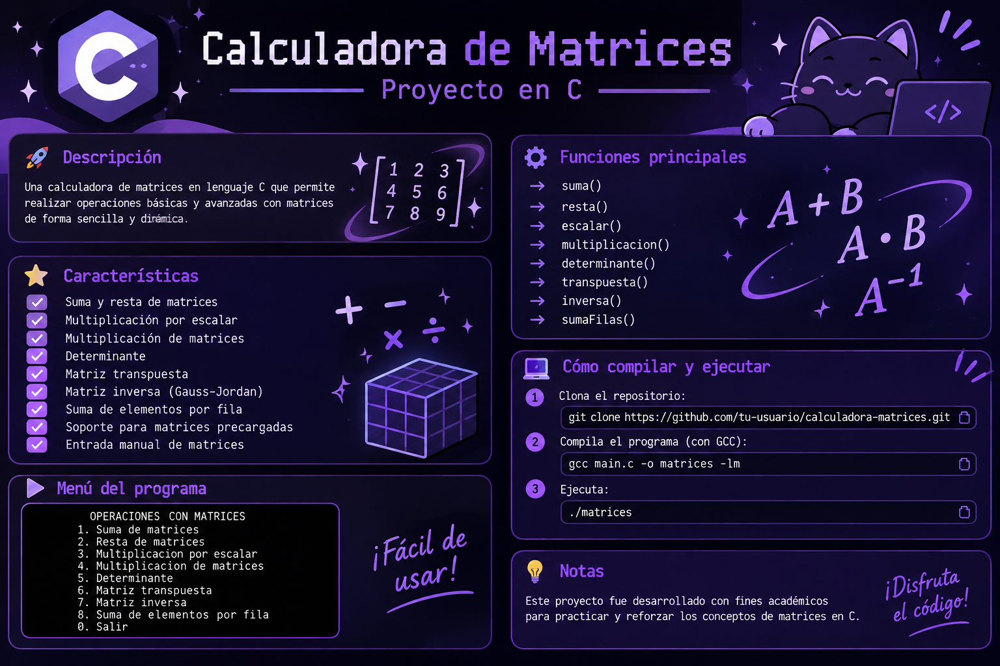

# ✦ Calculadora de Matrices

<p align="center">
  
</p>

<p align="center">
  
  
  
</p>

<p align="center">
  <i>Un proyecto académico dedicado al cálculo y manipulación de matrices mediante programación estructurada.</i>
</p>

---

## ✧ 1. Sobre el proyecto

La **Calculadora de Matrices** es un programa desarrollado en lenguaje C como parte de las actividades académicas de la asignatura de **Programación Básica**, correspondiente a la Licenciatura en Ingeniería en Ciencias de la Computación de la Benemérita Universidad Autónoma de Puebla (BUAP).

El programa permite realizar distintas operaciones matemáticas con matrices mediante un menú interactivo en consola.

El usuario puede ingresar sus propias matrices o seleccionar alguna de las cinco matrices precargadas. Posteriormente, puede elegir la operación que desea realizar y visualizar el resultado directamente en pantalla.

El desarrollo busca aplicar los fundamentos de programación estructurada mediante arreglos bidimensionales, funciones, punteros, ciclos y estructuras de control, relacionando estos conceptos con procedimientos matemáticos del álgebra lineal.

## ♡ 2. Características

- Suma y resta de matrices.
- Multiplicación por escalar.
- Multiplicación entre matrices.
- Cálculo de determinantes.
- Obtención de matrices transpuestas.
- Cálculo de matrices inversas.
- Suma de elementos por fila.
- Cinco matrices precargadas.
- Ingreso manual de matrices.
- Manejo de matrices de hasta **10 × 10**.
- Compatibilidad con matrices cuadradas y rectangulares.
- Validación de dimensiones y condiciones matemáticas.
- Organización del código mediante funciones independientes.

## ⌘ 3. Operaciones disponibles

| Opción | Operación | Descripción |
|:---:|---|---|
| 1 | Suma | Suma dos matrices de las mismas dimensiones. |
| 2 | Resta | Resta dos matrices de las mismas dimensiones. |
| 3 | Multiplicación por escalar | Multiplica cada elemento por un número real. |
| 4 | Multiplicación de matrices | Realiza el producto de matrices compatibles. |
| 5 | Determinante | Calcula el determinante de una matriz cuadrada. |
| 6 | Transpuesta | Intercambia las filas por las columnas. |
| 7 | Inversa | Calcula la matriz inversa cuando existe. |
| 8 | Suma por fila | Calcula la suma de los elementos de cada fila. |
| 0 | Salir | Finaliza la ejecución del programa. |

## ⚙️ 4. Especificaciones de las matrices

El programa permite trabajar con matrices de dimensiones variables, con un límite máximo de **10 filas y 10 columnas**.

Esto significa que no se restringe el uso a matrices cuadradas. También es posible trabajar con matrices rectangulares, por ejemplo:

- Matrices de 1 × 3.
- Matrices de 2 × 3.
- Matrices de 3 × 2.
- Matrices de 4 × 5.
- Matrices de 10 × 10.

Se utiliza el tipo de dato `double` para almacenar los elementos, permitiendo realizar operaciones con números enteros y decimales.

### Matrices precargadas

El programa incluye cinco matrices de dimensiones 3 × 3 que pueden seleccionarse durante la ejecución.

Estas matrices permiten realizar pruebas de las operaciones disponibles sin necesidad de ingresar manualmente todos los valores.

También es posible introducir matrices personalizadas mediante la captura de sus dimensiones y elementos.

## ✦ 5. Fundamento matemático

### Suma de matrices

Consiste en sumar los elementos que ocupan la misma posición:

\[
C_{ij}=A_{ij}+B_{ij}
\]

Condición: ambas matrices deben tener las mismas dimensiones.

### Resta de matrices

Consiste en restar los elementos correspondientes:

\[
C_{ij}=A_{ij}-B_{ij}
\]

Condición: ambas matrices deben tener las mismas dimensiones.

### Multiplicación por escalar

Cada elemento de la matriz se multiplica por un número real:

\[
B_{ij}=kA_{ij}
\]

### Multiplicación de matrices

Se obtiene mediante la suma de los productos correspondientes entre filas y columnas:

\[
C_{ij}=\sum_{k=1}^{n}A_{ik}B_{kj}
\]

Condición: el número de columnas de la primera matriz debe coincidir con el número de filas de la segunda.

Si \(A\) tiene dimensiones \(m\times n\) y \(B\) tiene dimensiones \(n\times p\), el resultado tendrá dimensiones \(m\times p\).

### Determinante

El determinante se calcula mediante eliminación por pivotes, aprovechando las propiedades de las operaciones elementales sobre filas.

Para una matriz de orden 2:

\[
\det(A)=ad-bc
\]

Para una matriz de orden 3:

\[
\det(A)=a(ei-fh)-b(di-fg)+c(dh-eg)
\]

En el procedimiento de eliminación, el determinante se obtiene a partir del producto de los elementos de la diagonal principal de la matriz triangular, considerando los cambios de signo ocasionados por los intercambios de filas.

### Matriz transpuesta

La transpuesta intercambia los índices de filas y columnas:

\[
(A^T)_{ij}=A_{ji}
\]

Por lo tanto, una matriz de dimensiones \(m\times n\) produce una transpuesta de dimensiones \(n\times m\).

### Matriz inversa

La matriz inversa se calcula mediante el método de Gauss-Jordan, utilizando operaciones elementales sobre filas.

Se parte de la matriz aumentada:

\[
[A\mid I]
\]

Mediante operaciones elementales se transforma hasta obtener:

\[
[I\mid A^{-1}]
\]

La inversa solamente existe cuando la matriz es cuadrada y su determinante es diferente de cero.

### Suma de elementos por fila

Se calcula la suma de todos los elementos correspondientes a cada fila:

\[
S_i=\sum_{j=1}^{n}A_{ij}
\]

El resultado consiste en una suma independiente para cada fila de la matriz.

## ⌘ 6. Métodos utilizados

| Operación | Procedimiento |
|---|---|
| Suma | Adición de elementos correspondientes. |
| Resta | Sustracción de elementos correspondientes. |
| Escalar | Multiplicación individual de elementos. |
| Multiplicación | Producto de filas por columnas. |
| Determinante | Eliminación por pivotes. |
| Transpuesta | Intercambio de filas y columnas. |
| Inversa | Método de Gauss-Jordan. |
| Suma por fila | Acumulación de elementos. |

## ⚙️ 7. Organización del código

El programa se encuentra organizado mediante funciones independientes. Cada una tiene una responsabilidad específica, facilitando la lectura, comprensión y mantenimiento del código.

### Funciones principales

| Función | Responsabilidad |
|---|---|
| `menu()` | Muestra las opciones disponibles. |
| `leer()` | Permite ingresar o seleccionar una matriz. |
| `mostrar()` | Imprime una matriz en consola. |
| `mostrarMatrices()` | Muestra las matrices precargadas. |
| `sumar()` | Realiza la suma de matrices. |
| `restar()` | Realiza la resta de matrices. |
| `escalar()` | Multiplica una matriz por un escalar. |
| `multiplicar()` | Realiza la multiplicación de matrices. |
| `determinante()` | Calcula el determinante. |
| `transpuesta()` | Obtiene la matriz transpuesta. |
| `inversa()` | Calcula la matriz inversa. |
| `sumaFilas()` | Suma los elementos de cada fila. |

### Uso de funciones y parámetros

Las matrices se manejan mediante arreglos bidimensionales y se pasan como parámetros a las funciones encargadas de realizar las operaciones.

También se utilizan parámetros para indicar las dimensiones de cada matriz.

En la función `leer()` se emplean punteros para devolver al programa principal el número de filas y columnas de la matriz ingresada.

De esta manera, el programa puede conocer las dimensiones reales de cada matriz y utilizarlas en las operaciones posteriores.

## 8. Validaciones y condiciones

Para evitar operaciones matemáticamente incorrectas, el programa contempla las siguientes condiciones:

- Las dimensiones ingresadas deben encontrarse dentro del límite permitido de 1 a 10.
- La suma y resta requieren matrices de las mismas dimensiones.
- La multiplicación requiere que las columnas de la primera matriz coincidan con las filas de la segunda.
- El determinante solamente puede calcularse para matrices cuadradas.
- La inversa requiere una matriz cuadrada con determinante diferente de cero.
- Las matrices singulares no tienen inversa.
- La transpuesta puede aplicarse a matrices cuadradas y rectangulares.
- La multiplicación por escalar puede aplicarse a cualquier matriz admitida.
- La suma por fila utiliza las dimensiones reales de la matriz.

## 9. Estructuras de programación utilizadas

Durante el desarrollo se aplicaron los siguientes elementos del lenguaje C:

| Elemento | Aplicación |
|---|---|
| `#include <stdio.h>` | Entrada y salida de datos. |
| `#include <math.h>` | Funciones matemáticas y operaciones numéricas. |
| `#define` | Definición de constantes y límites del programa. |
| Arreglos bidimensionales | Almacenamiento de matrices. |
| Funciones | Separación de las operaciones. |
| Punteros | Devolución de dimensiones desde `leer()`. |
| `if` y `else` | Validación de condiciones. |
| `switch` | Selección de operaciones. |
| `do-while` | Repetición del menú principal. |
| Ciclos `for` | Recorrido de filas y columnas. |

## 10. Tecnologías

- **Lenguaje:** C.
- **Bibliotecas:** `stdio.h` y `math.h`.
- **Compilador:** GCC.
- **Entorno de ejecución:** Consola o terminal.

## 11. Instalación y ejecución

### 1. Clonar el repositorio

```bash
git clone https://github.com/Salvadiux/calculadora-matrices.git
```

### 2. Entrar a la carpeta

```bash
cd calculadora-matrices
```

### 3. Compilar

```bash
gcc main.c -o matrices -lm
```

### 4. Ejecutar

En Linux:

```bash
./matrices
```

En Windows:

```bash
matrices.exe
```

> Es necesario tener instalado GCC para compilar el programa. La opción `-lm` enlaza la biblioteca matemática cuando es requerida.

## 12. Estructura del proyecto

```text
calculadora-matrices/
│
├── assets/
│   └── banner.png
│
├── main.c
│
└── README.md
```

## 13. Consideraciones sobre el desarrollo

Se decidió utilizar funciones independientes para que cada operación pudiera realizarse y comprenderse por separado, evitando concentrar toda la lógica del programa dentro de `main()`.

Asimismo, se implementó el manejo de dimensiones variables para permitir trabajar con matrices cuadradas y rectangulares, respetando las condiciones matemáticas de cada operación.

Los procedimientos de eliminación por pivotes y Gauss-Jordan permiten resolver operaciones de mayor complejidad sin recurrir a bibliotecas externas de álgebra lineal.

Estas decisiones mantienen el proyecto dentro de los fundamentos de programación básica y permiten relacionar los procedimientos matemáticos con su implementación mediante algoritmos.

## ♡ 14. Propósito académico

Este proyecto busca reforzar los conocimientos de programación estructurada mediante la aplicación de:

- Variables y tipos de datos.
- Arreglos bidimensionales.
- Funciones y parámetros.
- Punteros.
- Ciclos `for` y `do-while`.
- Condicionales `if` y `else`.
- Estructuras `switch`.
- Operaciones matemáticas.
- Validación de datos.
- Resolución algorítmica de problemas.

## ✧ 15. Conclusión

El desarrollo de esta calculadora permitió aplicar los fundamentos del lenguaje C en la resolución de problemas matemáticos mediante matrices.

A través de la implementación de arreglos bidimensionales, funciones, punteros, ciclos y estructuras de selección, se construyó un programa capaz de realizar distintas operaciones de álgebra lineal.

Además, se reforzó la relación entre los procedimientos matemáticos y su implementación mediante algoritmos, considerando las condiciones necesarias para que cada operación pueda realizarse correctamente.

---

<p align="center">
  <b>✦ Desarrollado con C y un poquito de creatividad. ✦</b>
  <br>
  <i>Elegance is control.</i>
  <br><br>
  
  
</p>
